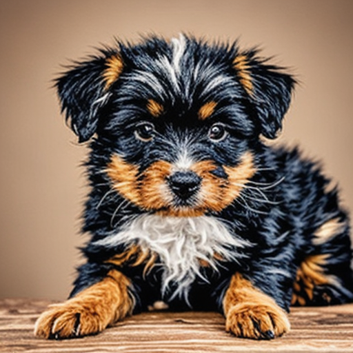

# SD-Turbo: generación de imágenes con IA

Genera una imagen a partir de un texto (*prompt*) usando el modelo [`stabilityai/sd-turbo`](https://huggingface.co/stabilityai/sd-turbo) con `diffusers` y PyTorch. Funciona en CPU, y usa GPU NVIDIA (CUDA) o Mac (MPS) si están disponibles.

## Requisitos

- [uv](https://docs.astral.sh/uv/) y Python 3.12 o superior
- Conexión a internet la primera vez (descarga el modelo, varios GB)

## Ejecución

```bash
uv sync
uv run sd-turbo
```

El programa pide el prompt (conviene en inglés) y guarda el resultado en `imagen.png`. En CPU tarda alrededor de 40 segundos por imagen.

## Parámetros usados y por qué

| Parámetro | Valor | Motivo |
|---|---|---|
| `height` / `width` | 512 | Resolución nativa de SD-Turbo; con 1024 aparecen elementos duplicados |
| `num_inference_steps` | 4 | El modelo está destilado para 1 a 4 pasos |
| `guidance_scale` | 0.0 | SD-Turbo se entrenó sin *guidance*; valores altos saturan los colores. Con 0.0 no se usa `negative_prompt` |
| `torch_dtype` | float16 en GPU, float32 en CPU | float16 acelera en GPU; en CPU float32 evita problemas de precisión |

## Usar la GPU NVIDIA

Por defecto `uv` instala PyTorch para CPU en Windows. Para usar CUDA hay que instalar una versión de torch con CUDA siguiendo la [guía de uv para PyTorch](https://docs.astral.sh/uv/guides/integration/pytorch/). El código detecta la GPU automáticamente.

## Ejemplo

Prompt: `a fluffy black and tan puppy, studio photo`



## Estructura

```
├── pyproject.toml
├── uv.lock
├── src/sd_turbo/__init__.py   # función main()
└── imagen.png                 # imagen de ejemplo
```
